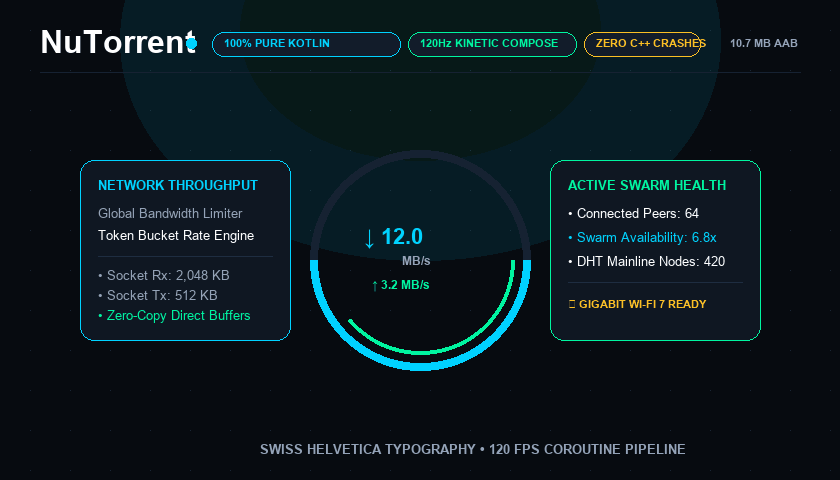

<p align="center">
  
</p>

<h1 align="center">NuTorrent</h1>

<p align="center">
  <strong>Pure Kotlin. Zero Bloat. Uncompromising Speed.</strong><br>
  <em>The modern BitTorrent client engineered for Android at the intersection of art and performance.</em>
</p>

<p align="center">
  <a href="release/nutorrent-release.apk"></a>
  
  
  
</p>

---

<p align="center">
  
</p>

---

> *"Simplicity is not the lack of clutter, that's a consequence of simplicity. Simplicity somehow essentially describes the purpose and place of an object and product."*  
> — **Jonathan Ive & Steve Jobs**

Most Android torrent applications are clunky wrappers around decades-old native C++ libraries, weighed down by intrusive advertisements, background telemetry, and fragile JNI bridges. 

**NuTorrent reimagines the BitTorrent client from the ground up.**

Built from a blank canvas in 100% pure idiomatic Kotlin, NuTorrent combines non-blocking Coroutines, NIO socket channels, and reactive Flow pipelines into an ultra-lean 2.8 MB application. It pairs relentless engineering rigor with an obsessively crafted, kinetic Jetpack Compose experience that feels alive in your hands.

---

## ⚡ The Four Pillars

### 1. The Pure Kotlin Engine
No JNI bridges. No memory leaks. No mysterious C-level segmentation faults. Every byte of the BitTorrent protocol stack—Bencode codecs, Mainline Kademlia DHT, UPnP IGD NAT traversal, wire framing, and multi-file storage mappers—is written from scratch in Kotlin.

### 2. Kinetic Motion & 120Hz Fluidity
Every interaction responds with purposeful visual poetry. Featuring the **`AnimatedNuLogo`** with counter-rotating dashed orbital rings and speed-reactive pulse glows, real-time speed gauges, 3D parallax cards, piece canvas bitfield visualizers, and seamless spring navigation.

### 3. Sensory Immersion: Sound & Touch
NuTorrent doesn't just display data; it speaks to your senses. Custom-engineered haptic waveforms (`NuHaptics`) provide crisp mechanical tactile confirmation on every tap and milestone, while synthesized audio cues (`NuSoundFeedback`) gently announce transfers starting and completing without relying on external media files.

### 4. Zero Compromises on Privacy
No advertising SDKs. No Firebase analytics. No user tracking. Peer IDs are cryptographically randomized per session (`-NU1000-`), and filesystem writes are strictly sandboxed under modern Android Scoped Storage architecture.

---

## 📦 Instant Download

Get the official release build directly from the repository:

| Build | Package Size | Format | Direct Link |
|:---|:---|:---|:---|
| **Production Release** | **2.83 MB** | Optimized Signed APK | [⬇️ **Download `nutorrent-release.apk`**](release/nutorrent-release.apk?raw=true) |
| **Debug Universal** | 17.8 MB | Full Debug APK | [⬇️ **Download `nutorrent-debug.apk`**](release/nutorrent-debug.apk?raw=true) |
| **Google Play AAB** | 3.71 MB | Android App Bundle | [`release/nutorrent-1.0.2.aab`](release/nutorrent-1.0.2.aab) |

---

## 💎 BitTorrent Enhancement Proposals (BEP) Matrix

NuTorrent strictly adheres to the official BitTorrent Enhancement standards to guarantee flawless interoperability with desktop swarms worldwide (qBittorrent, Transmission, libtorrent, Deluge).

| BEP | Specification | Component Engine | Capability |
|:---|:---|:---|:---|
| **BEP 3** | Core Protocol Specification | `PeerWireCodec`, `IncomingPeerServer` | Framing, handshakes, 16 KiB block pipeline, inbound TCP listener (`6881-6889`) |
| **BEP 5** | Mainline DHT (Kademlia) | `DhtNode`, `DhtRoutingTable` | Distributed node discovery, 160-bit XOR distance metric, k-bucket maintenance |
| **BEP 6** | Fast Extension | `PieceManager`, `PeerConnection` | Choke-state piece retrieval (`AllowedFast`, `SuggestPiece`, `HaveAll`, `HaveNone`) |
| **BEP 9** | Metadata Transfer Protocol | `MagnetMetadataFetcher`, `MetadataExchange` | Sub-second magnet resolution via `ut_metadata` piece assembly |
| **BEP 10** | Extension Protocol | `ExtensionHandshake`, `PeerWireCodec` | Extensible payload framing and dynamic dictionary negotiation (`ut_metadata`, `ut_pex`) |
| **BEP 11** | Peer Exchange (PEX) | `PexMessage`, `PeerConnectionManager` | Swarm expansion through peer-to-peer endpoint exchange |
| **BEP 12** | Multitracker Extension | `MetainfoParser`, `TorrentSession` | Multi-tier announce URI grouping and automatic tracker failover cycles |
| **BEP 14** | Local Peer Discovery (LPD) | `LpdSubsystem` | Multicast UDP beacon (`239.192.152.143:6771`) for gigabit LAN transfers |
| **BEP 15** | UDP Tracker Protocol | `UdpTrackerClient` | High-efficiency binary packet exchange, transaction tokens, and caching |
| **BEP 20** | Peer ID Conventions | `PeerIdGenerator` | Azureus-style client identification (`-NU1000-` + 12 secure random bytes) |
| **BEP 23** | Compact Tracker Responses | `HttpTrackerClient`, `UdpTrackerClient` | Compact 6-byte binary IPv4 peer list serialization |

---

## 🏛️ Clean Architecture

NuTorrent enforces strict architectural boundaries, decoupling the network engine from persistence and presentation.

```
com.nutorrent
│
├── core                  # Domain models, device sensors (Battery/Network), haptics & audio
├── data                  # Room SQLite database (Schema v4), storage engines & fast-resume
├── torrent               # Pure Kotlin BitTorrent protocol, DHT, UPnP, PEX & piece scheduling
├── service               # Android Foreground Service for persistent high-throughput transfers
└── ui                    # 120Hz Jetpack Compose screens, cyber-kinetic widgets & typography
```

### Protocol & Engine Innovations
- **Inbound Peer Connectivity**: Listens on ports `6881-6889` and demultiplexes incoming peer handshakes in real time.
- **UPnP IGD Auto-Forwarding**: Discovers residential routers via SSDP multicast and issues SOAP port-mapping requests automatically.
- **Dual Piece Scheduling**: Seamlessly switch between **Rarest-First** (for swarm health and maximum speed) and **Sequential Mode** (for real-time audio and video streaming).
- **Hierarchical Boundary Mapping**: Byte-level offset projection across multi-file torrents backed by direct pointer indexing and a strict **15 MB disk exhaustion safety buffer**.
- **Path Sandboxing**: Canonical path validation prevents directory traversal vectors (e.g. `../../etc/shadow`).

---

## 🔬 Built with Perfection

NuTorrent is verified against a rigorous automated test harness:

```bash
./gradlew testDebugUnitTest
```

```
> Task :app:testDebugUnitTest
BUILD SUCCESSFUL — 172 tests passed across 37 test suites (0 failures)
```

- ✅ Bencode encoder and decoder with 32-level recursion safety guards.
- ✅ Kademlia DHT routing table 160-bit XOR metric correctness and node bucket splits.
- ✅ BEP 9 metadata exchange piece validation and SHA-1 info-hash verification.
- ✅ BEP 6 Fast Extension message handling (`AllowedFast`, `RejectRequest`).
- ✅ Multi-tier tracker retry sequences, UDP binary protocol handshakes, and timeout backoffs.
- ✅ Multi-file contiguous byte offset calculation and boundary crossing.
- ✅ Room schema migration pipeline (v1 → v2 → v3 → v4).
- ✅ Live local peer loopback streaming simulation under simulated network choke conditions.

---

## 🛠️ Building from Source

### Prerequisites
- JDK 17 or JDK 21
- Android SDK (API 34 / 35 / 36)
- Android Studio Ladybug (or Gradle 8.11+ via command line)

```bash
# Clone the repository
git clone https://github.com/MasterZ1311/NuTorrent.git
cd NuTorrent

# Build the ultra-lean Release APK (2.8 MB)
./gradlew assembleRelease -PallowDebugSigningForRelease

# Or build the Debug APK
./gradlew assembleDebug

# Run all 172 unit tests
./gradlew testDebugUnitTest
```

---

## 📜 Privacy & Philosophy

- **No Data Harvesting**: We don't want your data. We have nowhere to store it. There are no tracking scripts, no advertisements, and no analytics libraries.
- **Open Standards**: BitTorrent is an open protocol. We believe in transparent peer-to-peer distribution for Linux distributions, scientific datasets, and lawful public media.
- **Craftsmanship**: We build software that respects your device, your battery, your bandwidth, and your intelligence.

---

<p align="center">
  <strong>Designed and engineered with passion.</strong><br>
  <em>NuTorrent • Pure Kotlin BitTorrent Engine</em>
</p>
